# Consensus Weather

  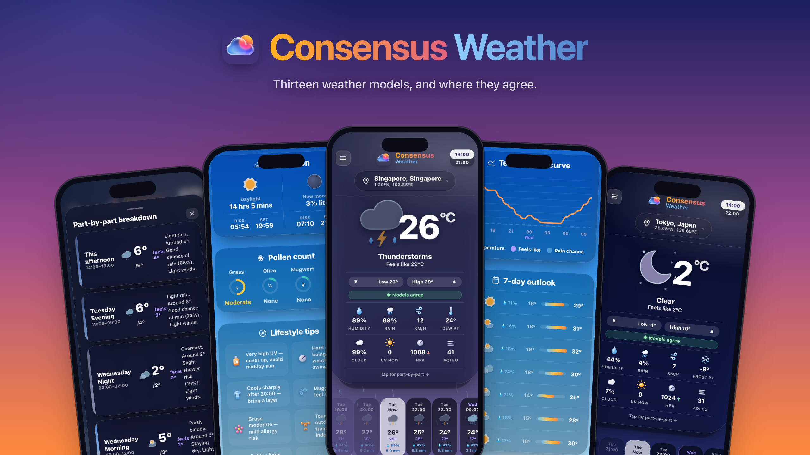

**Thirteen weather models, and where they agree.**

  
  
  

No app store, no account, no API key, no ads. Get the **Android app**, use it in any phone's browser, or sideload the **native iOS app**.

---

☕️ You can support me and Buy me a coffee ☕️

https://buycoffee.to/szebastian

---

## What's inside

- **🌍 One forecast from thirteen.** Every number is a live average of ECMWF, DWD ICON, NOAA GFS, MET Norway, Météo-France, JMA, ECCC GEM, the UK Met Office, KNMI, DMI, KMA, CMA and BOM, fetched from the free [Open-Meteo](https://open-meteo.com) API. Where a model doesn't cover your area, it simply sits out.
- **◆ How sure is it?** A badge under the temperature says whether the models agree, are roughly aligned or diverge. Tap it to see the warmest and coldest model and how far apart they are, or open the table of all thirteen.
- **⏱ The next 36 hours,** hour by hour: temperature, feels-like, rain chance and millimetres, with day and night shaded differently. Then a temperature curve and a **7-day outlook**.
- **🌗 Part-by-part.** Tap the main card for the night, morning, afternoon and evening, each in a sentence.
- **☀️ Sun & Moon:** daylight length, sunrise and sunset, moonrise, moonset and the moon's phase.
- **🌼 Pollen and air quality:** a live pollen count (alder, birch, grass, mugwort, olive, ragweed) and the European or US air-quality index, depending on where you are.
- **🧭 Lifestyle tips:** what to wear, UV, golden hour, whether to wash the car, storms brewing, poor visibility, and a biometeorological read-out of how the weather may feel on your body.
- **🌦 A living sky.** The background follows the time of day and the weather, with rain, snow, lightning, fog and blowing dust drawn on top. Light rain, downpours, showers, sleet, hail, thunderstorms, dust and sandstorms each get their own icon and sky.
- **📍 Up to 15 places.** Your GPS location plus any city you search for. Swipe left or right to switch.
- **📏 Your units:** °C or °F, km/h, m/s, mph or knots, and hPa or inHg.
- **🔔 Reports, not alarms (Android).** Up to three a day at times you choose, such as *Morning Report (Gliwice)*: what it's like now, the next 14 hours, rain and wind if they matter, and whether it's warmer or colder than yesterday. Plus a warning when a storm is on its way. They arrive even when the app is closed.
- **🗣 33 languages:** English, Polski, Deutsch, Українська, Español, Français, Русский, 中文, 日本語, Português, Nederlands, Italiano, हिन्दी, العربية, Ελληνικά, Čeština, Svenska, 한국어, Bahasa Indonesia, বাংলা, Türkçe, తెలుగు, Română, Magyar, Suomi, Norsk, Slovenčina, Kiswahili, فارسی, Dansk, ไทย, Tiếng Việt and Български. It opens in your phone's language; Arabic and Persian read right to left.

## Screens

  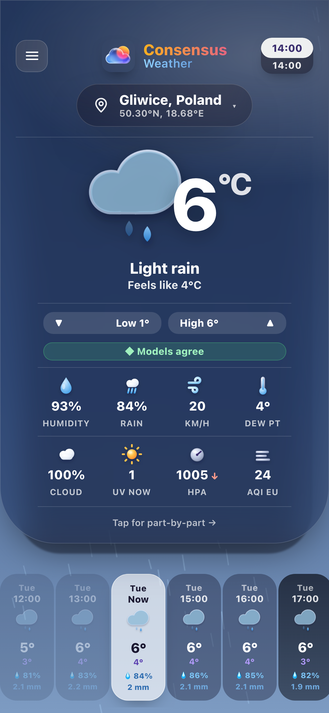
  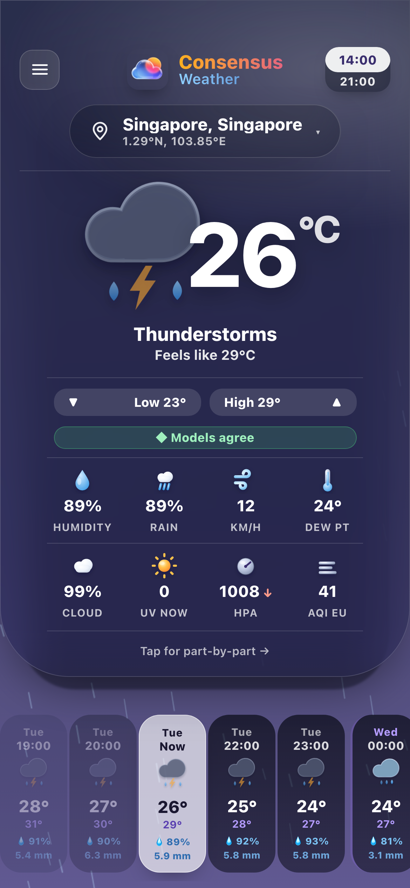
  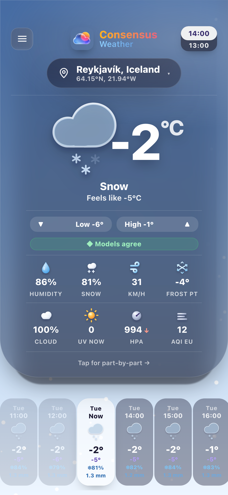
  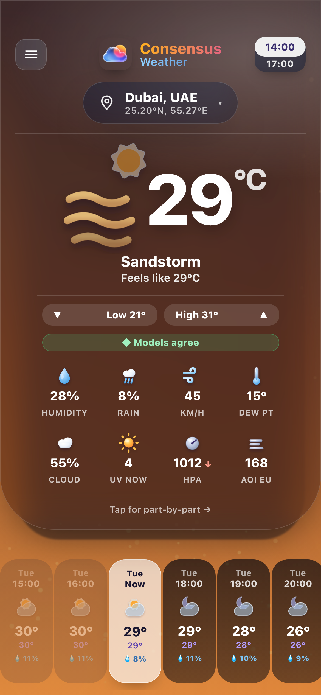
  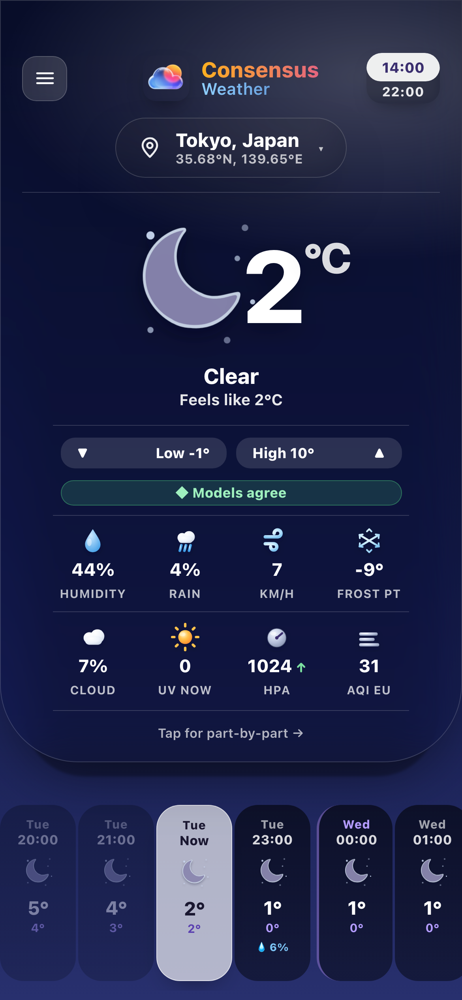

  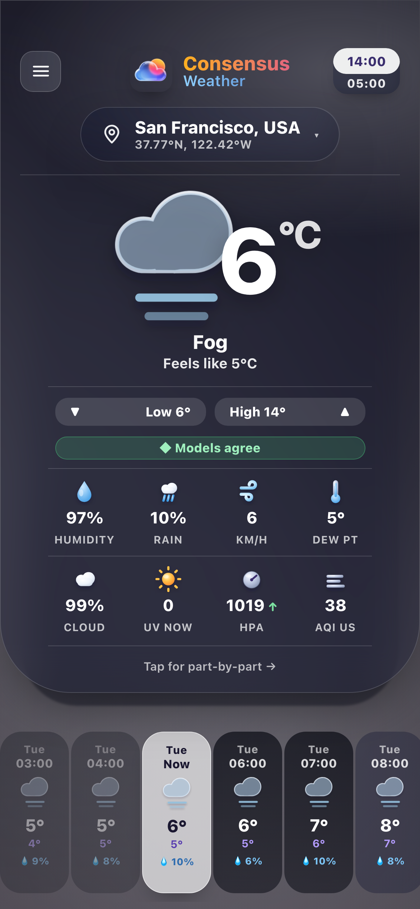
  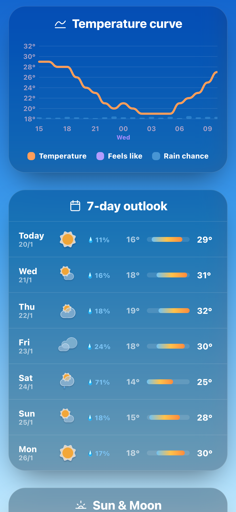
  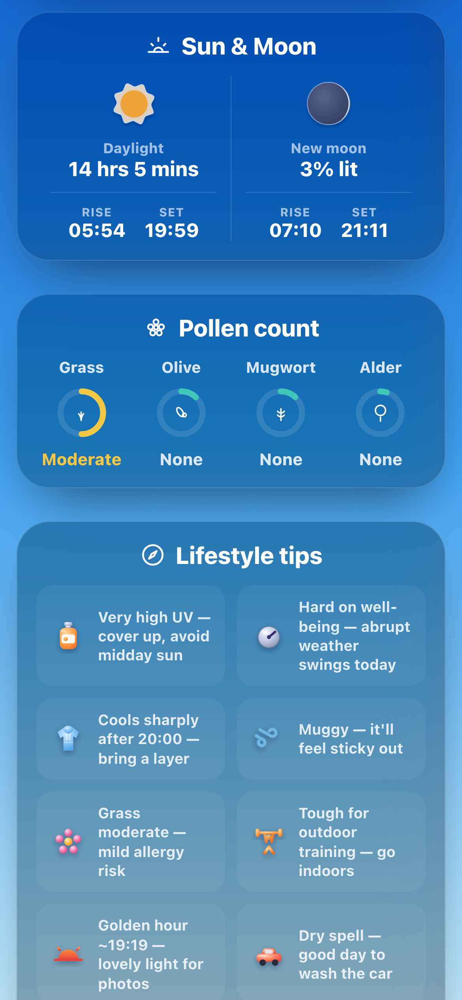
  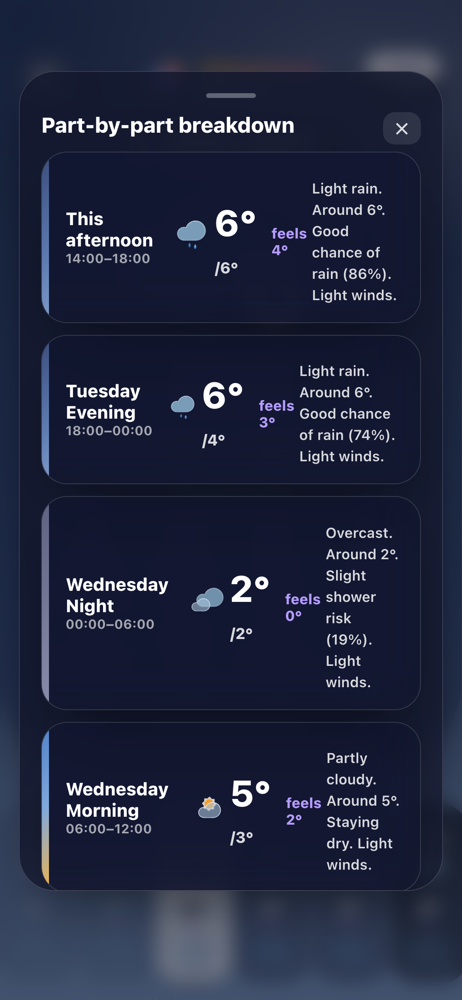
  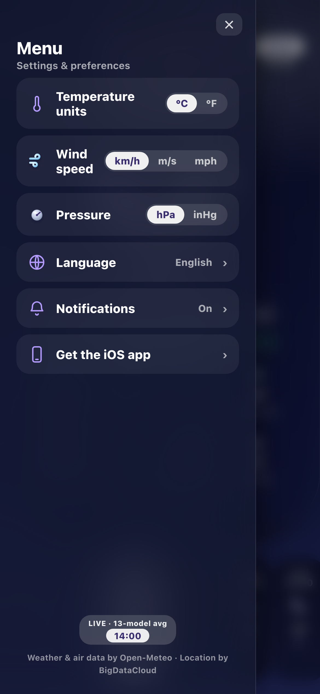

Rain · Storm · Snow · Sandstorm · Clear night · Fog · Week ahead · Sun, Moon &amp; tips · Part-by-part · Menu

## Getting started

### Android app (recommended)

1. Open **[Releases](https://github.com/Szebastian31/Consensus_Weather/releases/latest)** on your phone and download **Consensus_Weather_v….apk**.
2. Open the file. If Android asks, allow your browser to **install unknown apps**.
3. Open Consensus Weather and allow **location** (optional) and **notifications**.

Works on Android 7 and newer, up to Android 16.

### iPhone or any browser

1. Open **[szebastian31.github.io/Consensus_Weather](https://szebastian31.github.io/Consensus_Weather/)**.
2. **iPhone (Safari):** tap **Share**, then **Add to Home Screen**. **Android (Chrome):** tap **⋮**, then **Install app**.

Notifications are only in the Android app.

### Native iOS app

A SwiftUI version lives in [`ios/`](ios). GitHub builds it as an **unsigned .ipa**, which iPhones won't open on their own: install it with **AltStore** or **Sideloadly** and a free Apple ID, and re-install every 7 days. The [install guide](https://szebastian31.github.io/Consensus_Weather/ios.html) has the steps and the download.

## An honest note about accuracy

- **An average isn't magic.** Averaging thirteen models usually beats any single one, but when they disagree the average can describe weather none of them expects. That's why the agreement badge is there: when it says the models diverge, trust the forecast less.
- **The headline condition** is the one most models vote for, so a storm that only three models see won't take over the screen. The source table shows each model's own high and low.
- **Rain chance** is the models' average probability, not the share of the day it rains.
- **Pollen and air quality** come from Open-Meteo's CAMS-based model, not from a sensor near you, and pollen data only covers Europe well.
- **No connection?** Gliwice ships as an offline snapshot so the app still shows something; every other city needs internet.

## Privacy

There's no account and no server of mine. Your cities, units and language are saved on your phone only. The app asks Open-Meteo for the forecast of the places you add, and BigDataCloud for the name of the town you're in when you use GPS. Location is optional: without it you just won't have the 📍 shortcut.

## Questions or ideas?

Found a bug? [Open an issue](https://github.com/Szebastian31/Consensus_Weather/issues) and describe what happened, which phone you use and which browser.

---

_Consensus is Latin for agreement, literally "feeling together". It's a sibling to Kalendae, Augur, Fidelis, Vestis, Caelum and Hora._

For developers

The whole app is one self-contained file, `docs/index.html`: HTML, CSS and JavaScript with no libraries and nothing loaded from a CDN. The chart, every icon, the sun and moon maths (a trimmed SunCalc) and the weather effects (a small canvas particle engine) are hand-rolled, so it renders offline. The effects respect reduced motion and pause when the app is hidden.

The Android app (`app/`) loads the same file from `app/src/main/assets/index.html` in a native WebView shell that draws edge to edge, adds pull-to-refresh, GPS and the daily reports. Reports are composed natively by `WeatherNotifier.java` with an inexact daily alarm, re-planned after a restart, so they work while the app is closed. It targets Android 16 (API 36) with AGP 8.13 and Gradle 8.13, handles back through the new back callback (keeping `onBackPressed` for Android 15 and older), and if it ever crashes it shows the error on the next start so it can be shared. GitHub Actions builds the APK on every push and publishes it as a release.

| Where | What it is |
| --- | --- |
| `docs/index.html` | The app: layout, styles, data, all 33 languages. GitHub Pages serves it |
| `app/src/main/assets/index.html` | The same file, bundled into the APK |
| `app/src/main/java/com/consensus/weather/MainActivity.java` | WebView shell: edge to edge, insets, back, GPS, crash screen |
| `app/src/main/java/com/consensus/weather/WeatherNotifier.java` | Daily reports and storm warnings, composed natively |
| `ios/` | The SwiftUI app (XcodeGen project, built unsigned by `.github/workflows/ios.yml`) |
| `docs/ios.html` | The iOS install guide |
| `tools/screenshots.sh` | Makes everything in `screenshots/` from the real app in demo mode |
| `.github/workflows/build.yml` | Builds the APK and publishes it as a release |

After changing the app, copy `docs/index.html` over `app/src/main/assets/index.html` so both stay the same, and bump `versionName` + `versionCode` in `app/build.gradle` for a new APK release (the release and the APK name come from `versionName`).

**Screenshots:** `tools/screenshots.sh` (or `tools/screenshots.sh pl` for Polish). It needs Google Chrome and touches none of your own data. Without it, `docs/index.html?demo&city=3` shows the same made-up weather in any browser: cities 0–6 are Gliwice (rain), Singapore (storm), Reykjavík (snow), Dubai (sandstorm), Tokyo (clear night), Cape Town (sun) and San Francisco (fog), with the clock stopped at 20 January 2026, 13:00 UTC. Add `&screen=parts`, `menu`, `lang`, `agree`, `notif` or `locs` to open a sheet, and `&at=.tips` to scroll to a card.

**Data:** weather, air quality and pollen from [Open-Meteo](https://open-meteo.com) (CC-BY 4.0), city search from the Open-Meteo Geocoding API, and GPS → town name from [BigDataCloud](https://www.bigdatacloud.com). Please keep the Open-Meteo attribution if you reuse the app.

## License

Released under the [MIT License](LICENSE).
